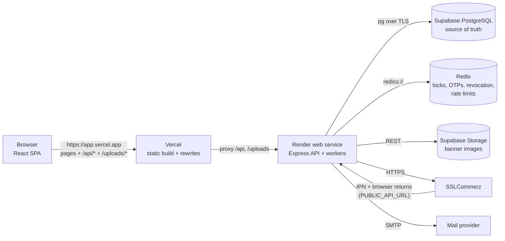

# TicketFlow — Architecture

## 1. System overview

- The browser only talks to the Vercel domain; Vercel forwards `/api/*` and `/uploads/*` to the API, so the httpOnly session cookie is first-party (`SameSite=Lax`, `Secure`).
- The API process also runs the background workers (hold expiry, notification outbox + reminders).
- Optional single-host mode: `FRONTEND_DIST_DIR` lets the API serve the built web app itself (used by the Playwright stack).
- In development the React app runs on Vite (`:5173`) and proxies `/api` to the API (`:4000`).

## 2. Backend layers

`routes → middlewares → controllers → services → domain → repositories → PostgreSQL / Redis`

| Layer | Responsibility | Examples |
| --- | --- | --- |
| `routes/` | URL → handler wiring, guards per route | `booking.routes.ts`, `dashboard.routes.ts` |
| `middlewares/` | cross-cutting HTTP concerns | `clientIp` (trusted client identity, optional direct-access block), `auth` (JWT cookie, `requireRole`), `validate` (Zod), `rateLimiter`, `upload` (multer, memory only), `spa`, `errorHandler` |
| `controllers/` | HTTP in/out only; no SQL, no business rules (enforced by ESLint import rules) | `BookingController`, `UploadController` |
| `services/` | orchestration and transactions | `BookingService`, `PaymentService`, `CancellationService`, `NotificationDispatcher`, `ReminderService`, `DashboardService`, `EventBannerService` |
| `domain/` | pure rules and interfaces | pricing strategies, booking state machine, `PaymentGateway`, `NotificationChannel`, refund rule, image detection, `FileStorage` |
| `repositories/` | SQL and Redis access | `BookingRepository`, `PaymentRepository`, `NotificationRepository`, `DashboardRepository` |
| `infrastructure/` | drivers and adapters | `Database` (transactions with retry), `RedisLockManager`, `RedisTtlStore`, `RedisRateLimitStore`, payment adapters, SMTP sender, `LocalFileStorage` |
| `container.ts` | composition root: builds every object once and injects dependencies | test seams via `ContainerOverrides` |

`app.ts` builds the Express app from injected dependencies (no I/O), so tests create it with an embedded database and in-memory Redis, and `server.ts` creates it with real adapters.

## 3. Design patterns (where they earn their place)

| Pattern | Where | Why |
| --- | --- | --- |
| **Strategy** | `domain/pricing`: `BasePriceStrategy`, `EarlyBirdStrategy`, registry chosen per event | new pricing rules without touching booking code |
| **Adapter** | `PaymentGateway` ← `MockProviderA`, `MockProviderB`, `SslCommerzAdapter` | providers are interchangeable; booking/payment services never see provider details |
| **State machine / transition guard** | `domain/lifecycle/bookingStateMachine.ts` + `BookingLifecycle` + DB triggers | only `HELD → PENDING_PAYMENT → CONFIRMED | EXPIRED | CANCELLED`; every change written to `booking_status_history` |
| **Observer** | `BookingLifecycle.onTransition` → `NotificationDispatcher.onBookingTransition` | notifications react to lifecycle events without changing booking code |
| **Transactional outbox** | `notifications` rows written in the transition's transaction, delivered by workers | a commit can never lose a notification, a rollback never sends one |
| **Repository** | `repositories/*` | SQL/Redis isolated from services |
| **Dependency inversion** | services depend on interfaces (`PaymentGateway`, `NotificationChannel`, `EmailSender`, `FileStorage`, `TtlStore`) | swap infrastructure in tests and deployments |

## 4. Key flows

### 4.1 Seat hold (zero double booking)
1. Validate input, load the event (published, on sale).
2. Acquire Redis locks `seat_hold:{event}:{seat}` for all requested seats atomically (Lua, owner = booking id, TTL = hold).
3. One PostgreSQL transaction: advisory lock per `(user, event)` → count active tickets (`HELD`, `PENDING_PAYMENT`, `CONFIRMED`) + requested ≤ 6 → insert booking `HELD` + `booking_seats` (`idx_active_seat_per_event` partial unique index rejects any seat already `HELD`/`BOOKED`) → history row.
4. On any failure the Redis locks are released. The database index is the final guarantee even if Redis is unavailable or a lock expires.

### 4.2 Payment and confirmation
1. `POST /api/bookings/:id/payments` with `Idempotency-Key`: the key (hashed with the user) maps to one payment attempt; a retry returns the same attempt, never a second charge. Only one open attempt per booking (unique index).
2. The gateway is called after commit; hosted providers return a redirect URL.
3. Confirmation only after **server-side verification** (signed webhook / IPN **and** provider validation API), amount and currency matched, inside a transaction that re-checks owner, state and `hold_expires_at > now()`.
4. Late or duplicate captures are recorded and refunded automatically; unknown outcomes are reconciled by the worker.

### 4.3 Cancellation and refund
Lock booking → verify any open attempt first → decide refund (`> 24 h` before start: full, else none) → `CANCELLED`, seats `RELEASED`, refund row, history, cancellation notifications in one transaction → provider refund after commit, retried with backoff (`refund_trans_id` derived from the attempt's idempotency key).

### 4.4 Notifications and reminders
- Lifecycle observer enqueues Email + In-App rows (dedupe key `type:booking:channel`).
- `IntervalWorker` (every `NOTIFICATION_WORKER_INTERVAL_MS`): `ReminderService.scheduleDue()` claims confirmed bookings starting between 1 hour and `REMINDER_WINDOW_MINUTES` from now (`FOR UPDATE SKIP LOCKED`, sets `reminder_sent_at`) → `NotificationDispatcher.deliverDue()` claims due rows with a lease, delivers through the channel, retries failures with exponential backoff, skips reminders whose event already started.

### 4.5 Client identity and sign-in throttling
Vercel middleware (`frontend/middleware.ts`) proxies `/api` and `/uploads` and adds an HMAC-signed client IP → `clientIp` middleware accepts it if valid and fresh, else uses `CLIENT_IP_HEADER` or `req.ip` (exactly `TRUST_PROXY` hops) → all IP limiters key on `req.clientIp` → `AuthService.login` calls `LoginThrottle.attempt(email, ip)` (atomic Redis counters per account and per IP) before checking the password.

### 4.6 Banner upload
`multer` (memory, 1 file, ≤ 2 MB, MIME allowlist) → `EventBannerService.validate` (magic bytes must match the declared type) → random `<uuid>.<ext>` key → `FileStorage.put` (`LocalFileStorage`: path confined to the upload root; `SupabaseFileStorage`: private bucket; neither overwrites) → event row updated in a transaction (ownership + editable status) → old file removed.

## 5. Frontend

React 19 + React Router. Feature folders (`features/auth`, `events`, `bookings`, `payments`, `organizer`, `notifications`, `dashboard`, `admin`) each own their API module (`createXApi(client)`, injectable for tests) and pages. Shared UI lives in `components/` (feedback, form fields, stats). `useAsync` handles loading/error/refresh with abortable requests; `AuthContext` holds the session; `ProtectedRoute` is a UX guard (the API enforces the real rules). Every page has loading, empty and error states and is responsive.

## 6. Data and consistency

PostgreSQL is the source of truth; Redis only coordinates (locks, TTLs, counters) and can be flushed without data loss. Integrity rules live in the database too: partial unique indexes (active seat, one successful/open payment, one active refund), composite foreign keys, transition triggers for bookings/seats/payments, append-only history and audit tables, RLS enabled with API roles revoked. See [DATABASE_DESIGN.md](DATABASE_DESIGN.md).

## 7. Testing and delivery

- Jest unit + integration on a real PostgreSQL (embedded locally, a service container in CI), concurrency suite with real Redis, live checks, SSLCommerz sandbox suite, frontend Testing Library suites, Playwright journeys on a self-contained stack.
- GitHub Actions: quality (lint, format, typecheck, build, no committed `.env`), backend tests + coverage, concurrency (PostgreSQL + Redis services), frontend tests + coverage, Playwright, Claude Code security review on PRs.
- Deployment: Render native Node web service (API, deploys `main` after CI passes, migrations at the end of the build), Vercel (web app, deploys `main` on push), Supabase PostgreSQL + Storage, managed Redis.
